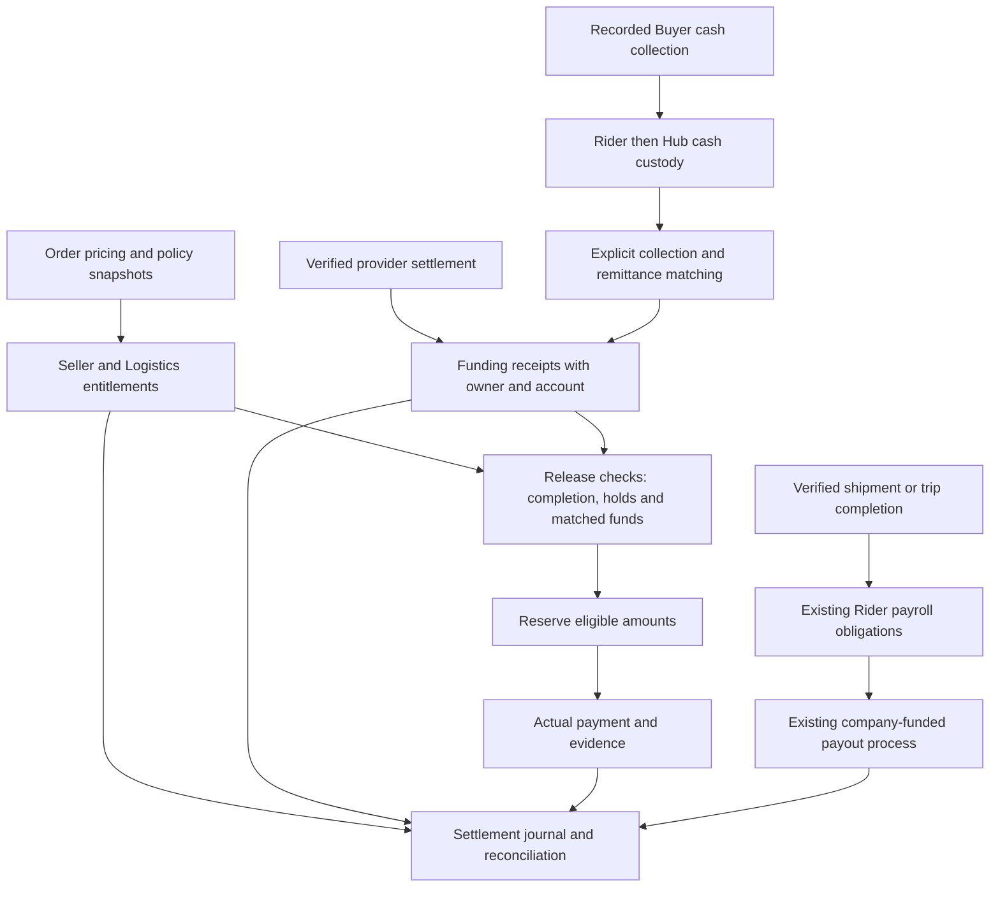

# ALONA Money Distribution and Settlement Plan

Reviewed against local source on 10 November 2026. Status: proposed design, not implemented or approved business policy. Amounts in examples are illustrative PHP amounts, not configured rates.

## 1. Objective and implementation boundary

Account for each order's merchandise, shipping, discounts, funding, liabilities, cash custody and actual payments. Give Sellers, Riders, Logistics owners and Admin a consistent explanation of money owed, held, available and paid.

Build an additive settlement journal and reconciliation view over existing operational ledgers. Preserve historical seller-funded delivery charges, buyer-funded Rider payroll and COD records. A unified view must not create a second earning or second payment for an existing obligation.

Use **held funds** in the product until an actual escrow arrangement is established; a database status does not create an escrow account. First delivery is manual, evidence-backed settlement. Automated bank/GCash/Maya transfers are a separate provider integration, not a consequence of changing a status.

This document authorizes no application changes, migration, backfill, actual payment or deployment. Future implementation must follow project checkpoint and isolated-test requirements.

## 2. Verified baseline and corrections to the original proposal

Source paths below are relative to the backend repository root. They describe inspected code, not verified production behavior.

| Area | Current source | Required planning correction |
|---|---|---|
| Commission | `app/Services/CommissionService.php` uses 10% of gross item amounts; `app/Http/Controllers/SellerReportController.php` uses 5% after seller-funded discounts. Both use floating-point calculations. | Resolve the rate **and base** before settlement rollout. Introduce one versioned minor-unit calculator; do not silently recalculate historical earnings. |
| Seller balance | `SellerReportController::calculateSellerBalances()` derives earnings from order/item states and deducts payout requests. It does not establish matched COD or provider settlement. | Operational completion alone cannot make funds withdrawable. Reserve identifiable entitlements and funded amounts. |
| Seller payout | `AdminPayoutStatusController::updateStatus()` updates status/notes without transfer evidence in that method; its dashboard includes approved requests in total disbursed. | Approval, reservation and actual payment must be separate. Require real receiving details; replace the seller request path's fallback account number. |
| Rider work unit | `app/Services/RiderJobPay.php` snapshots pickup/delivery pay per Seller-order shipment; transfer pay is once per closed trip manifest. | Preserve these units. Do not change delivery or transfer pay to per parcel. A trip can cover several orders. |
| Earning event | Pickup requires receipt of all active shipment parcels; delivery requires all active parcels delivered with valid Rider photos. `Logistics/RiderDeliveryController.php` verifies OTP only when supplied in the inspected handler, despite older docs describing required OTP. Transfer requires every manifest transfer received. | Use existing completion services; do not invent `ARRIVED_AT_SORTING_CENTER` or accept one scan for a whole shipment. Confirm the intended OTP policy and reconcile source/tests before rollout; do not claim mandatory OTP is currently enforced. |
| Rider funding | `RiderJobPay::pay()` records full manual company-payroll payment. Rates are owner-configured; COD custody is separate. | Earn on completed work, regardless of remittance timing. No automatic COD wage offset or new digital wallet balance. |
| COD | `app/Services/CodLedger.php` exposes `collect`, `submit`, `confirm`, `approve`. Collections identify order/parcel; remittances identify Rider/company and aggregate amounts. | There is no `confirmRemittance` method or remittance-to-order allocation. Add explicit matching before order funding release. Discrepancy approval does not create cash. |
| Online payment | `BuyerOrderController::paymentWebhook()` accepts order/status/reference and marks paid; no provider-signature, amount/currency or settled-funds validation appears in that handler. Its Buyer `pay()` path also accepts a success action without provider settlement evidence in that method. | Treat these as rollout blockers for monetary release. Verify provider events and actual settlement; `payment_status=paid` is insufficient. |
| Completion window | `Order::autoCompleteDeliveredOrders()` uses seven days; `routes/console.php` schedules it daily. | This is operational completion, not a verified funds-release rule. Add independent dispute/return/funding checks and test scheduler retries. |
| Historical funding | `docs/DELIVERY_FINANCE.md` preserves the seller-funded PHP 50/10/40 ledger. New buyer-funded work uses separate configured payroll. | Never apply both delivery liabilities to the same work or backfill old settlements implicitly. |

Additional references: `docs/RIDER_PAY_IMPLEMENTATION.md`, `app/Models/CodCollection.php`, `app/Models/CodRemittance.php`, `app/Models/RefundLedger.php`, `app/Models/SellerPayoutRequest.php`, and `routes/api.php`.

Repository discrepancy: this checkout contains `mobile/alona_mobile`, including Rider features, but no `mobile/rider` or its checkpoint helper/integration bundle. Some guidance still names the old directory. Restore or correct that checkpoint workflow before future integration implementation; this review changes documentation only and does not repeat completed integration phases.

## 3. Separate entitlement, funding, custody and payout



Company, hub, beneficiary and funding-account ownership must be explicit. Cash received by a Logistics hub is not automatically cash in ALONA's disbursing account. Record the custody transfer or approved funding arrangement between those entities before the platform can use it for Seller payouts.

Shipping revenue belongs to the contracted Logistics party under an approved allocation policy. Rider payroll is that company's separate cost and payable. An order-level Rider cost allocation is reporting attribution, not another payable. Do not both distribute the full shipping fee to Logistics and pay the same Rider costs again from that order.

## 4. Money rules and worked examples

### 4.1 Canonical amounts

Use integer centavos for all new calculations and storage; rates use integer basis points. APIs serialize exact amounts as decimal strings. No client-side financial authority or binary-float arithmetic. Validate currency, nonnegative input components and integer range.

Snapshot at checkout: seller/item identities, price/quantity, merchandise discounts by funder, gross/net shipping, shipping subsidy funder, fee payer, policy version, commission base/rate and rounding rule. Snapshot Rider rates at assignment using the existing service. Do not reconstruct ownership or discounts from mutable products/vouchers later.

For a single settlement unit, before returns and separately disclosed fees:

```text
G  = gross merchandise
Ds = seller-funded merchandise discount
Dp = platform-funded merchandise discount
S  = gross quoted shipping
Dh = shipping discount, with an explicitly identified funder
B  = amount charged to Buyer = G - Ds - Dp + S - Dh

M  = commission base; proposed M = G - Ds, subject to owner approval
C  = round_half_up(M * commission_basis_points / 10000)
Seller entitlement = G - Ds - C
Logistics gross entitlement = S, only if policy promises full quoted shipping

B + Dp + Dh = Seller entitlement + C + S
```

That last equation is an **economic allocation identity**, not proof that the subsidy cash exists. Record sponsor obligations separately; only funded contributions become usable cash. If Logistics funds a shipping discount by accepting less revenue, reduce its entitlement accordingly instead of inventing an external subsidy receipt. Reject discounts exceeding their applicable base.

Gross shipping is not necessarily the Logistics entitlement: settle that contract explicitly. Merchandise commission excludes shipping under the proposed policy. Payment processing fees are expenses assigned to an approved bearer; a processing margin is not assumed. Taxes/withholding and payout fees require a separately approved treatment before any applicable rollout; no rates are invented here.

For a shared trip, choose and snapshot a reporting allocation method (for example, parcel count or weight). Allocate integer-cent residuals by largest remainder, tie-breaking by stable shipment ID. The allocated costs must sum to the **one** trip earning; do not multiply the trip payment by the number of orders.

### 4.2 Balanced example with funded discounts

Illustrative policy only: PHP 1,000 merchandise, PHP 40 Seller discount, PHP 60 platform discount, PHP 100 shipping, PHP 20 externally funded shipping subsidy, 10% commission after Seller discount.

| Component | PHP |
|---|---:|
| Buyer payment: 1,000 - 40 - 60 + 100 - 20 | 980.00 |
| Platform merchandise subsidy | 60.00 |
| Shipping sponsor subsidy | 20.00 |
| Total required funding | **1,060.00** |
| Seller entitlement: 960 - 96 | 864.00 |
| Platform gross commission: 960 x 10% | 96.00 |
| Logistics gross entitlement | 100.00 |
| Total entitlements | **1,060.00** |

If Logistics pays PHP 25 pickup + PHP 15 allocated trip cost + PHP 45 delivery, its contribution before other costs is PHP 15. This is not net profit. Platform gross commission also excludes subsidy costs, gateway fees and refunds. No optional COD incentive is introduced without an approved rate, trigger and funder.

### 4.3 Free shipping and a cost shortfall

If Buyer shipping is zero, gross Logistics entitlement is PHP 50 and a sponsor promises PHP 50, funding is still pending until that contribution is funded. If Rider costs total PHP 85, Logistics contribution is **negative PHP 35**. Show the loss and responsible funder; do not clamp it to zero, deduct it from merchandise proceeds, or reduce already earned Rider pay.

For paid transactions, reconcile actual money separately:

```text
Opening cash + confirmed receipts + funded contributions
  - confirmed payouts - actual refunds - actual fees = closing cash

Opening payable + recognized entitlements + signed adjustments
  - confirmed payments = closing payable
```

Perform cash reconciliation per actual account and currency. Inter-account transfers have matched legs and cancel in consolidated reporting. Balanced journals must still be reconciled with evidence and source events; a balanced but missing transaction is still an error.

## 5. Release and exception rules

### Seller

Track separate dimensions: entitlement (`pending`, `recognized`, `adjusted`), funding (`unfunded`, `partial`, `funded`), hold (`clear`, `held`) and payout (`unreserved`, `reserved`, `paid`). These are proposed conceptual states, not replacements for existing order statuses.

Availability requires all of the following for the relevant settlement unit:

1. Verified fulfillment or the approved store-pickup receipt flow, plus the approved release time/event.
2. No blocking return, refund, dispute or administrative hold. Buyer receipt cannot bypass a hold or missing funds.
3. Matched, usable funding sufficient for the amount released, including required subsidies and assigned fee costs.
4. No prior reservation/payment of those same centavos; authorized payee and receiving instructions are present.

Recommended first version releases only fully eligible units. Partial receipts remain visible but do not release an entire order. Explicitly approve a narrower item-level partial-release policy before supporting it. Seven-day operational auto-completion does not establish eligibility by itself.

### Rider

Keep existing pending assignment -> earned work -> prepared batch -> paid batch -> optional Rider acknowledgment flow. Remittance does not create or unlock wages. Reassignment/handover, disabled rates, partial shipment completion and cancelled parcels retain existing `RiderJobPay` rules. Returns do not erase previously earned/paid work; additional return pay requires a new approved policy.

### COD matching

1. Record actual cash against its collection/order/parcel and validate the expected collectible amount across the order. Do not charge the full order total on every parcel. Existing `CodLedger::collect()` does not itself reconcile entered amounts to the order total; add that validation and exception handling before automatic release.
2. Keep submitted remittance pending until actual receipt is confirmed. Submission/proof upload alone is not receipt.
3. Add allocation lines from each confirmed remittance to specific collections. Permit a collection to be funded across several receipts and a receipt to cover several collections, subject to locked amount caps and company/currency scope.
4. Keep unallocated cash, shortfalls and excess collections in explicit unresolved/suspense records. A discrepancy decision alone neither settles an order nor zeroes Rider liability.
5. Record whether funds are in Rider custody, Hub custody, company bank or platform bank. Evaluate disbursing-account availability separately.
6. Re-evaluate eligibility after funding **and** after fulfillment/hold changes, in either event order. Enforce exactly one financial effect on retries.

Example: Rider owes PHP 1,000 across Orders A (PHP 600) and B (PHP 400), but remits PHP 600. Explicitly matching all PHP 600 to A funds only A. B remains unfunded and Rider custody remains PHP 400. A is withdrawable only if its other eligibility checks pass.

### Online payments

Authenticate provider events using the selected provider's supported verification; validate merchant/account, transaction ID, order allocation, amount and currency. Uniquely record event IDs and handle duplicate/out-of-order events. Distinguish authorization, capture, provider receivable and actual usable settlement, including net fees. A browser success page or current order flag is not funding evidence.

Handle payment received after cancellation/expiry as an exception/refund case; do not revive fulfillment blindly. Chargebacks remain possible after settlement. Provider-specific behavior and automated transfers must be designed against its documentation once a provider is chosen.

### Refunds and failed payouts

Place holds before releasing disputed amounts. For partial returns, use snapshotted item/discount allocations and explicit rules for commission, shipping, subsidy and fee reversals. Link each adjustment to the original entry and refund case; never edit paid history. A refund after payout creates a separately approved recovery/loss obligation, not a silent wage or COD deduction.

Reserve refunds and payouts against the same available funding under locks. Distinguish requested refund from actual refunded money. On provider timeout keep payout `unknown/reconciling`; query the existing transfer before retrying. Release reservations only after confirmed nonpayment, not after a timeout alone. Manual payouts require exact amount, account, reference, private proof, actor and time. `Approved` must not count as disbursed.

## 6. Proposed additive data model and service boundaries

These are design candidates to refine against existing migrations, not approved schema changes.

| Record | Responsibility and constraints |
|---|---|
| `settlement_policies` | Immutable revision, effective date, commission base/rate, discount funding, release and rounding rules. No retroactive policy edits. |
| `order_settlements` | Order/seller/currency/legal-entity scope and immutable pricing snapshot. Unique business key; mutable summary states are rebuildable projections. |
| `settlement_lines` | Merchandise/shipping entitlement, fee, subsidy, hold/release or linked adjustment with beneficiary and source. Support multiple legs/parties instead of fixed Rider-share columns. |
| `settlement_accounts`, `settlement_journals`, `settlement_entries` | Balanced postings by entity/currency for cash, receivables, payables and approved revenue/cost categories. Journal source key unique; posted lines immutable; corrections use linked reversing/adjusting entries. |
| `funding_receipts`, `funding_allocations` | Actual funding owner/account, evidence and collection/provider source; allocated amount cannot exceed usable receipt or required entitlement. COD matching explicitly references collection and remittance IDs. |
| `settlement_payout_items` | Reserve identifiable Seller settlement amounts under existing payout requests. Adapt the existing Rider batch/item records rather than creating another Rider payment mechanism. |
| `settlement_holds`, `settlement_adjustments` | Scoped reason, amount, actor, evidence and lifecycle for disputes/refunds/recovery; preserve original facts. |
| `settlement_outbox` | Durable event-to-journal work, unique source-event key, retry count and error/reconciliation state. |

Do not create one “immutable” row at checkout and then overwrite it on delivery. Freeze facts, append events, and update only derived lifecycle projections. Trip cost allocations and journal mirrors reference existing earnings/payments and never generate duplicate liabilities.

Suggested services: a canonical `SettlementCalculator`, `SettlementJournal`, `FundingMatcher` and `SettlementEligibility`. Keep physical work in `RiderJobPay`, custody in `CodLedger`, and legacy seller-funded work in `SellerShipmentFinance`. All consumers use the same backend projections.

Write the operational event and outbox atomically; workers post idempotently. Define a lock hierarchy that respects existing order -> parcel -> Rider paths and Rider -> remittance/batch paths. Do not acquire order locks inside `CodLedger::confirm()` while holding Rider locks. Process matching/release separately with a documented consistent lock order and bounded deadlock retries.

Use unique constraints, foreign keys, positive allocation amounts and currency/owner validation as database backstops. Same idempotency key + same payload returns the original result; different payload returns conflict. Enforce aggregate caps inside locked transactions. Payout preparation must reserve both the entitlement and its disbursable funding. Do not call external transfer APIs inside a retried database transaction.

## 7. User experience and permissions

Extend existing screens first; the original proposed `/seller/wallet`, `/sorting-center/finance` and `/admin/payouts` must not be assumed to exist. Verified entry points include Seller `/seller/earnings`, Logistics `/sorting-center/payouts`, Admin `/admin/payout-requests`, Rider `/api/rider/job-pay` and owner `/api/sorting-center/payroll` APIs.

| Viewer | Display | Authority |
|---|---|---|
| Seller | Gross, each funded discount, commission base/rate/version, net entitlement, held/unfunded/available/reserved/paid, release reason and payout evidence | Own records and permitted payout requests only |
| Rider | Existing job units/rates and earned/prepared/paid totals; separate cash collected, pending remittance and remaining custody | Own cash submissions, receiving instructions and receipt acknowledgment |
| Hub Staff | Authorized hub receipt/matching queues, discrepancies and custody totals | Scoped cash operations only; no company payroll/rate or platform payout authority |
| Logistics owner | Company shipping entitlement/funding, Rider costs, operating contribution, unresolved shortfalls and existing payroll batches | Own company finances; no access to another company's funds |
| Admin | Funding-to-entitlement reconciliation, holds, unresolved events, actual disbursements and historical policy cohorts | Explicit authorized settlement actions with audit trail |

A preparation reserves funds; a proof upload does not send money. Show contribution before overhead instead of “profit.” Do not invent a 6 PM remittance deadline; display only an approved configured deadline. Keep proof files private, mask account details, and never include credentials/OTP in audit logs. Preserve current mobile design.

## 8. Delivery phases and acceptance gates

Phase labels below apply only to this new settlement proposal, not completed Rider integration phases.

| Phase | Deliverable | Exit gate |
|---|---|---|
| S0: Decisions and source map | Resolve commission conflict, beneficiary/funding ownership, discount policy, release rules, opening balances and existing payment weaknesses. Restore/check the applicable checkpoint workflow. | Written policy decisions, event/state map and reviewed examples; no rate guesses. |
| S1: Calculator and shadow journal | Add exact arithmetic, immutable policy snapshots, journal/outbox and source adapters in isolated fixtures. Shadow reporting creates no withdrawable money. | Balanced postings, source coverage, replay/rounding tests and no duplicate legacy/payroll earnings. |
| S2: Funding and reconciliation | Explicit COD matching, custody/account transfers, verified provider settlement and funded subsidy records. | Partial receipts, fees, mismatches and refunds reconcile; no unsupported “paid” flag can release funds. |
| S3: Controlled Seller release and manual payout | Eligibility/holds, entitlement/funding reservations, payout evidence/state machine and existing screen updates. | Cross-role denial, concurrency and failed/unknown payment recovery pass; Rider payroll remains independent. |
| S4: Operational rollout and optional automation | Owner-approved schema rehearsal/cutover, monitoring, actual provider integration if separately selected. | Reviewed target-schema delta, reconciled opening balances, isolated concurrency evidence and explicit operator authorization. |

Roll out by a recorded policy version/cutover cohort. Import historical outstanding obligations only through reviewed opening balances linked to original records; do not replay history as new revenue. Existing paid records remain intact. Shadow/adapted records are nonpayable until the existing payout authority is disabled for that same cohort, preventing dual payouts.

Do not automatically run migrations, commits, pushes or backfills. Before an authorized upgrade read `TEAMMATE_AI_HANDOFF.md` and `docs/upgrade/LOGISTICS_SCHEMA_MANIFEST.json`. Missing settlement schema must leave existing operations available but block the **new** financial release feature. Rollback disables new release/payment actions while preserving the journal and reconciliation access; it does not delete payment history.

## 9. Verification matrix

Use isolated SQLite `:memory:` fixtures and mocked HTTP for application tests. No development/production database tests or real payment calls. Production-engine locking remains a separate authorized exercise in a disposable isolated environment; SQLite cannot certify MySQL contention.

| Scenario | Required evidence |
|---|---|
| Baseline, discounted and free-shipping orders | Approved rate/base, exact cent arithmetic, funding/entitlement identity, visible deficits |
| Multiple sellers/parcels and shared trips | No duplicated shipping, order cash collection or job pay; trip allocation sums to one trip earning |
| COD submitted, short, excess or partial | Only actual matched usable amounts count; residual custody/suspense preserved |
| Completion before funding and funding before completion | Same final eligibility; one release; holds always block affected amounts |
| Duplicate/reordered webhooks, retries and crashes | One receipt/posting; wrong signature, merchant, amount or currency rejected; outbox recovers |
| Concurrent reserve/cancel/pay/refund | No double spend; reserved/paid/available totals consistent; unknown transfer not retried blindly |
| Partial/full refunds before and after payout | Correct immutable adjustments, allocated discount/fee policy and explicit recovery/loss |
| Rate change, reassignment, return, incomplete work | Historical snapshots retained; current Rider earning rules preserved |
| Store pickup and seller-funded legacy cohort | No new courier pay for store pickup; no historical duplicate charge or payout |
| Cross-user/company access and proof retrieval | Unauthorized reads/writes denied; private evidence and recipient details protected |
| Scheduler, missing schema, disabled feature and cutover | Holds/funding rechecked; no balance manufactured; existing operations preserved |
| Reconciliation | Journal balance plus source completeness, bank/custody match, aged holds/unallocated cash, no orphaned obligations |

Run targeted existing suites after relevant implementation changes: `tests/Feature/Logistics/CodLedgerTest.php`, `RiderJobPayTest.php`, `SellerShipmentFinanceTest.php`, plus `tests/Feature/AdminCommissionAutomationTest.php`, `BuyerPaymentTest.php`, `BuyerReturnRefundTest.php` and Seller payout coverage located during implementation. Do not claim those suites passed from this document review.

## 10. Decisions needed before implementation

| Decision | Recommended proposal, pending approval |
|---|---|
| Commission rate/base | Explicitly resolve current 5% versus 10%; one snapshotted rate on merchandise after Seller-funded discount, excluding shipping. No automatic historical repricing. |
| Rider units/rates | Retain per-shipment pickup/delivery and per-manifest-trip transfer, with existing owner-configured positive rates. No new numeric rates or COD bonus assumed. |
| Logistics revenue ownership | Name beneficiary company/entities and any inter-company/hub split. Treat internal hubs as cost centers unless separately payable by contract. |
| Subsidies, fees and deficits | Identify funder and expense bearer for every discount/fee; company funds payroll shortfalls. Unfunded promises cannot back withdrawals. |
| Seller release | Approve the exact release event/window and hold policy. Retain operational seven-day completion unless separately changed; always require funding and clear holds. |
| Payout channels and limits | Manual evidence-backed payments first; review existing PHP 100 Seller minimum. Require verified actual instructions rather than fallback account numbers. |
| COD allocation | Explicit reviewed collection allocations first; any FIFO automation needs a versioned rule and visible allocation details. |
| Returns and losses | Define merchandise/shipping/commission/subsidy treatment, reserves and post-payout recovery ownership. |
| Provider and historical cutover | Select provider/funding accounts before automation; reconcile opening balances and map each cohort to one payout authority. |

## 11. Review outcome and evidence limits

This revision corrects the original proposal's unsupported automatic escrow/wallet promises, conflicting pay units, remittance-to-order assumption and incomplete conservation equation. It adds verified implementation gaps, exact funding examples, state separation, additive schemas, exception handling and acceptance gates.

Validation for this revision is documentation/source review, example arithmetic and file/link consistency only. No application tests, live provider checks, database access, migrations, payment transfers, runtime changes or completed integration phases were performed. Source takes precedence over older documentation; deployment behavior and business decisions remain unverified.
